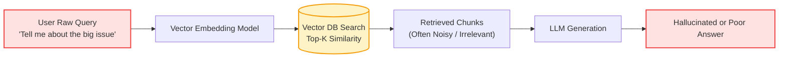
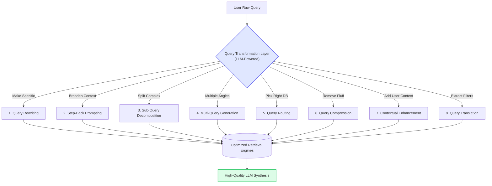

# 00 - The Problems with Naive RAG

## 1. What is "Naive RAG"?

Think of **Naive RAG** (Retrieval-Augmented Generation) like asking a busy library clerk for help:

> **You:** *"Tell me about the big issue."*  
> **Clerk:** Searches the computer database for the exact words *"big issue"*.  
> **Result:** Finds a book about large magazine publications, completely missing your intent about climate change or economic inflation!

In technical terms, Naive RAG takes whatever text the user types, immediately turns it into a vector embedding, searches a vector database for the top $K$ nearest chunks, and feeds those chunks into an LLM.

---

## 2. Why Does Naive RAG Fail in the Real World?

Human queries are rarely formatted like perfect search index entries. Real users make typos, ask multifaceted questions, use vague pronouns, or paste entire paragraphs.

Here are the **6 core failure modes** of Naive RAG:

### 1. The Semantic Mismatch Gap (Vocabulary Mismatch)
* **The Problem:** The user uses casual phrasing or slang, while the documentation uses formal academic or technical terms.
* **Example:** User searches *"Why is my app lagging?"*, but the knowledge base only has documents discussing *"Latency mitigation in distributed message brokers"*. Vector distance may fail to bridge this vocabulary gap.

### 2. Ambiguity & Under-Specification
* **The Problem:** The query is too brief to contain sufficient semantic signal.
* **Example:** User types *"pricing"*. Does this mean enterprise tiers, student discounts, cancellation refund policies, or API usage token costs? Naive RAG picks chunks arbitrarily.

### 3. Complex Multi-Part Questions (Query Overload)
* **The Problem:** A single query contains 3 different questions wrapped into one sentence.
* **Example:** *"How do solar panels work, how much do they cost in California, and what are the tax rebates in 2026?"*
* **Why it fails:** A single vector embedding tries to average out all three topics. In vector space, this "averaged" embedding lands in the middle of nowhere, retrieving chunks that barely graze each topic instead of thoroughly answering any of them.

### 4. Overly Verbose & Conversational Queries (Noise Pollution)
* **The Problem:** Users often type like they are speaking to a friend:
* **Example:** *"Hey assistant, I was wondering if you could take a look and maybe tell me what the biggest benefit of RAG is compared to regular LLMs?"*
* **Why it fails:** Filler words (*"Hey assistant"*, *"wondering if you could"*) dilute the dense keyword density needed for high-cosine similarity matches.

### 5. Multi-Turn Pronoun Amnesia
* **The Problem:** In a chat, humans use pronouns like *"it"*, *"they"*, or *"that"*.
* **Example:**
  - Turn 1: *"Explain Kubernetes clusters."*
  - Turn 2: *"How do I scale them?"*
* **Why it fails:** Searching the vector database with just *"How do I scale them?"* yields zero useful results because the word *"Kubernetes"* is missing from the query!

### 6. Semantic vs. Structured Data Conflict (The Metadata Blindspot)
* **The Problem:** Vector databases are great at semantic meaning (*"papers about neural networks"*), but terrible at hard logical boundaries (*"published after 2023 with citation count > 50"*).
* **Why it fails:** Naive vector similarity doesn't know how to filter dates, categories, or prices.

---

## 3. The Solution: Query Transformation

Instead of passing the raw user query directly to the vector store, we introduce a **Query Transformation Layer**:

By transforming, enriching, decomposing, or translating the question first, we ensure the retriever receives queries tailored for high-precision vector and metadata matching.

---

## Next Up
Explore the first and most widely used transformation technique:
👉 [01 - Query Rewriting](./01_query_rewriting.md)
