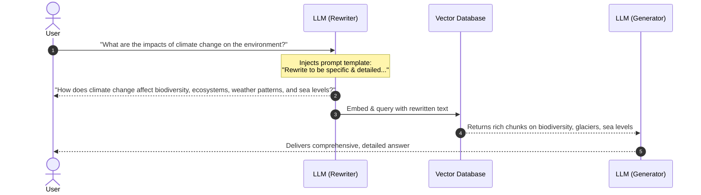

# 01 - Query Rewriting

## 1. Concept at a Glance

**Query Rewriting** (also known as Query Expansion or Query Refinement) takes a user's original, often vague or brief question and instructs an LLM to reformulate it into a **detailed, explicit, and search-optimized query**.

> **Analogy:** Think of an architect turning a napkin sketch (*"I want a house"*) into a detailed blueprint (*"A two-story contemporary residential home with 3 bedrooms, reinforced concrete foundation, and solar roofing"*).

---

## 2. Why is Query Rewriting Necessary?

In a vector database, documents are indexed with rich, technical vocabulary. When a user asks a short question like:
> *"What are the impacts of climate change on the environment?"*

A naive search might only match documents that repeat those exact generic words. A rewritten query explicitly expands the scope to include sub-topics that indexers use:
> *"How does climate change affect various aspects of the environment, such as biodiversity, ecosystems, weather patterns, and sea levels?"*

Now, documents discussing *sea-level rise*, *coral reef bleaching*, and *drought cycles* will immediately match with high similarity!

---

## 3. Workflow Diagram



---

## 4. Live Notebook Example

### Input vs. Output

| Type | Query Text |
| :--- | :--- |
| **Original Query** | *"What are the impacts of climate change on the environment?"* |
| **Rewritten Query** | *"How does climate change affect various aspects of the environment, such as biodiversity, ecosystems, weather patterns, and sea levels?"* |

### Why this performs better:
1. **Higher Keyword Coverage**: Words like *biodiversity*, *ecosystems*, and *sea levels* are strong semantic anchors.
2. **Reduced Vector Drift**: Prevents the embedding from landing near generic opinion pieces or elementary definitions.

---

## 5. Python Implementation (Notebook & Modern LCEL)

```python
from langchain_openai import ChatOpenAI
from langchain_core.prompts import PromptTemplate
from langchain_core.output_parsers import StrOutputParser
from dotenv import load_dotenv

load_dotenv()

# 1. Initialize the LLM (Low temperature for deterministic, focused rewriting)
re_write_llm = ChatOpenAI(temperature=0, model_name="gpt-4o", max_tokens=4000)

# 2. Define the rewriting prompt template
query_rewrite_template = """You are an AI assistant tasked with reformulating user queries to improve retrieval in a RAG system. 
Given the original query, rewrite it to be more specific, detailed, and likely to retrieve relevant information.

Original query: {original_query}

Rewritten query:"""

query_rewrite_prompt = PromptTemplate(
    input_variables=["original_query"],
    template=query_rewrite_template
)

# 3. Create the modern LCEL chain with StrOutputParser
query_rewriter = query_rewrite_prompt | re_write_llm | StrOutputParser()

def rewrite_query(original_query: str) -> str:
    """Rewrite query to improve retrieval precision."""
    return query_rewriter.invoke({"original_query": original_query})

# Execution
original_query = "What are the impacts of climate change on the environment?"
print("Rewritten:", rewrite_query(original_query))
```

---

## 6. Trade-offs & Production Tips

| Consideration | Benefit / Drawback | Recommendation |
| :--- | :--- | :--- |
| **Latency** | ⚠️ Adds 1 extra LLM call (~300-600ms) | Use a fast, small model like `gpt-4o-mini` or fine-tuned SLM for rewriting. |
| **Cost** | ⚠️ Extra prompt & completion tokens | Cache common rewritten queries in Redis or local memory. |
| **Intent Drift** | ⚠️ Model may introduce unwanted assumptions | Keep temperature at `0.0` and use strict prompt constraints (*"Do not answer the query; only reformulate it"*). |

---

## Next Up
Explore how to step back and generate broader conceptual queries:
👉 [02 - Step-Back Prompting](./02_step_back_prompting.md)
