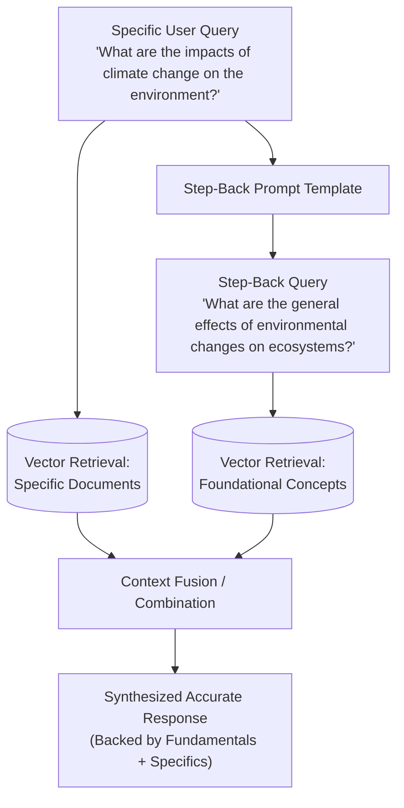

# 02 - Step-Back Prompting

## 1. Concept at a Glance

**Step-Back Prompting** (developed by Google DeepMind) takes a specific, narrow question and "steps back" to generate a **broader, higher-level conceptual question**.

> **Analogy:** Imagine a student struggling with a physics question:  
> *"Why did the tire pressure on my car drop from 35 PSI to 30 PSI on a freezing night?"*  
> A smart tutor first asks the step-back question:  
> *"What is the physical law governing gas pressure and temperature in a sealed container? (Gay-Lussac's Law)"*  
> By retrieving the fundamental principle first, solving the specific problem becomes easy.

---

## 2. Why Does Step-Back Prompting Improve RAG?

In many knowledge bases, documentation covers **core principles, architectures, and theoretical foundations** in broad terms, while user questions frequently ask about **niche symptoms or hyperspecific edge cases**.

If you search the vector database using only the hyperspecific question, you may retrieve zero chunks. But by retrieving:
1. The **Step-Back Query** chunks (high-level foundational concepts).
2. The **Original Query** chunks (specific details).

The generation model receives both the **contextual principle** and the **specific facts**, resulting in vastly fewer hallucinations.

---

## 3. Workflow Diagram



---

## 4. Live Notebook Example

### Input vs. Output

| Type | Query |
| :--- | :--- |
| **Original Query** | *"What are the impacts of climate change on the environment?"* |
| **Step-Back Query** | *"What are the general effects of environmental changes on ecosystems and biodiversity?"* |

### Why this works:
* The original query asks for specific real-world outcomes.
* The step-back query pulls in foundational ecological principles, making the final synthesized answer deep, scientific, and accurate.

---

## 5. Python Implementation (Notebook & Modern LCEL)

```python
from langchain_openai import ChatOpenAI
from langchain_core.prompts import PromptTemplate
from langchain_core.output_parsers import StrOutputParser
from dotenv import load_dotenv

load_dotenv()

# Initialize LLM
step_back_llm = ChatOpenAI(temperature=0, model_name="gpt-4o", max_tokens=4000)

# Step-Back Prompt Template
step_back_template = """You are an AI assistant tasked with generating broader, more general queries to improve context retrieval in a RAG system.
Given the original query, generate a step-back query that is more general and can help retrieve relevant background information.

Original query: {original_query}

Step-back query:"""

step_back_prompt = PromptTemplate(
    input_variables=["original_query"],
    template=step_back_template
)

# Modern LCEL Chain
step_back_chain = step_back_prompt | step_back_llm | StrOutputParser()

def generate_step_back_query(original_query: str) -> str:
    """Generate high-level abstraction of the query for background context."""
    return step_back_chain.invoke({"original_query": original_query})

# Execution
query = "What are the impacts of climate change on the environment?"
step_back = generate_step_back_query(query)
print("Step-back query:", step_back)
```

---

## 6. Dual Retrieval Integration Pattern

To put Step-Back Prompting into full practice in your RAG pipeline, query your retriever twice and concatenate the documents:

```python
def retrieve_with_step_back(query: str, retriever):
    # 1. Generate step-back query
    step_back_q = generate_step_back_query(query)
    
    # 2. Retrieve for both queries
    docs_specific = retriever.invoke(query)
    docs_foundational = retriever.invoke(step_back_q)
    
    # 3. Deduplicate by document ID or content
    seen_ids = set()
    combined_docs = []
    for doc in docs_specific + docs_foundational:
        if doc.metadata.get("id") not in seen_ids:
            seen_ids.add(doc.metadata.get("id"))
            combined_docs.append(doc)
            
    return combined_docs
```

---

## Next Up
Explore how to break complex, multi-intent questions into smaller, atomic tasks:
👉 [03 - Sub-Query Decomposition](./03_sub_query_decomposition.md)
