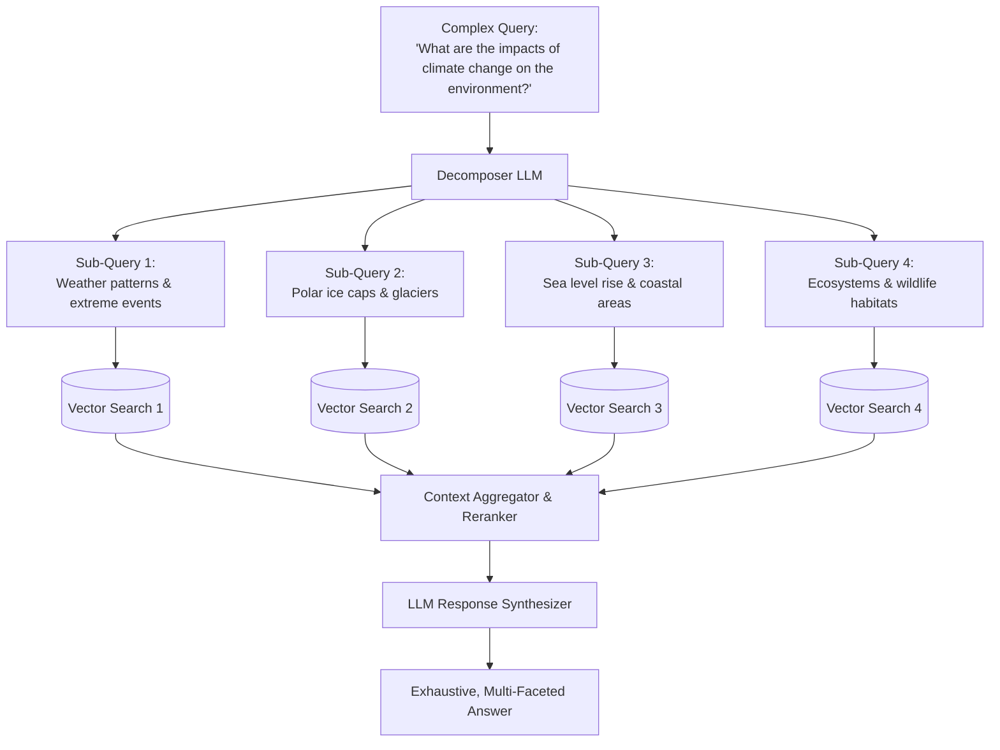

# 03 - Sub-Query Decomposition

## 1. Concept at a Glance

**Sub-Query Decomposition** takes a large, multifaceted, or complex question and breaks it down into **2 to 4 independent, simpler sub-queries**.

> **Analogy:** If you ask a travel agent:  
> *"Plan my vacation to Rome including budget flights, boutique hotels near the Colosseum, and the best pasta spots."*  
> The agent doesn't type that entire block into one search box. They break it down into 3 separate searches:
> 1. *"Roundtrip budget flights to Rome in May"*
> 2. *"Boutique hotels within walking distance of the Colosseum"*
> 3. *"Top authentic pasta restaurants in central Rome"*

---

## 2. Why is Decomposition Essential for Complex Queries?

When a query has multiple intents, a single vector embedding creates a **"semantic compromise"**:

```
Vector("Impact on oceans") + Vector("Impact on agriculture") + Vector("Impact on glaciers")
                          = Blurred Average Vector
```

Because the single vector is pulled in multiple directions at once, the vector database returns chunks that touch upon the topic in general, but lack in-depth answers for any specific part.

With decomposition:
* Each sub-query gets its own dedicated, high-precision retrieval pass.
* All retrieved chunks are merged and organized.
* The LLM synthesizes a complete, multi-part answer where every sub-question is explicitly answered.

---

## 3. Workflow Diagram



---

## 4. Live Notebook Example

### Input vs. Decomposed Output

**Original Query:**  
> *"What are the impacts of climate change on the environment?"*

**Generated Sub-Queries:**
1. *"How does climate change affect weather patterns and extreme weather events?"*
2. *"What are the impacts of climate change on ecosystems and wildlife habitats?"*
3. *"How does climate change influence sea levels and coastal areas?"*
4. *"What are the effects of climate change on freshwater resources and availability?"*

Each sub-query targets an isolated document cluster in the vector space, eliminating information gaps.

---

## 5. Python Implementation

### A. Notebook LCEL Implementation
```python
from langchain_openai import ChatOpenAI
from langchain_core.prompts import PromptTemplate
from dotenv import load_dotenv

load_dotenv()

sub_query_llm = ChatOpenAI(temperature=0, model_name="gpt-4o", max_tokens=4000)

subquery_decomposition_template = """You are an AI assistant tasked with breaking down complex queries into simpler sub-queries for a RAG system.
Given the original query, decompose it into 2-4 simpler sub-queries that, when answered together, would provide a comprehensive response to the original query.

Original query: {original_query}

example: What are the impacts of climate change on the environment?

Sub-queries:
1. What are the impacts of climate change on biodiversity?
2. How does climate change affect the oceans?
3. What are the effects of climate change on agriculture?
4. What are the impacts of climate change on human health?"""

subquery_decomposition_prompt = PromptTemplate(
    input_variables=["original_query"],
    template=subquery_decomposition_template
)

subquery_decomposer_chain = subquery_decomposition_prompt | sub_query_llm

def decompose_query(original_query: str) -> list[str]:
    response = subquery_decomposer_chain.invoke({"original_query": original_query}).content
    sub_queries = [
        q.strip() 
        for q in response.split('\n') 
        if q.strip() and not q.strip().startswith('Sub-queries:')
    ]
    return sub_queries
```

### B. Modern Pydantic Structured Output (Recommended)
```python
from pydantic import BaseModel, Field

class DecomposedQueries(BaseModel):
    sub_queries: list[str] = Field(
        description="2 to 4 simple, focused sub-queries covering all aspects of the original query"
    )

structured_decomposer = sub_query_llm.with_structured_output(DecomposedQueries)

result = structured_decomposer.invoke(
    f"Decompose into 2-4 sub-queries: {original_query}"
)
# result.sub_queries is guaranteed to be a valid Python list of strings!
```

---

## 6. Execution Modes: Sequential vs. Parallel

Depending on dependencies between sub-queries, there are two primary execution patterns:

1. **Parallel Execution (Default - SubQuestionQueryEngine style)**:
   - All sub-queries are independent.
   - Run all retrievals simultaneously via `asyncio.gather`.
   - Fast, low-latency, high coverage.

2. **Sequential / Multi-Step Execution (StepDecompose style)**:
   - Query 2 depends on the answer to Query 1.
   - *Example:* *"Who was the CEO of Apple in 2005 and what is his hometown?"*
   - Step 1: Find CEO in 2005 (Steve Jobs).
   - Step 2: Find hometown of Steve Jobs (San Francisco).

---

## Next Up
Explore how to generate multiple phrasings of the *same* question for maximum recall:
👉 [04 - Multi-Query Generation](./04_multi_query_generation.md)
