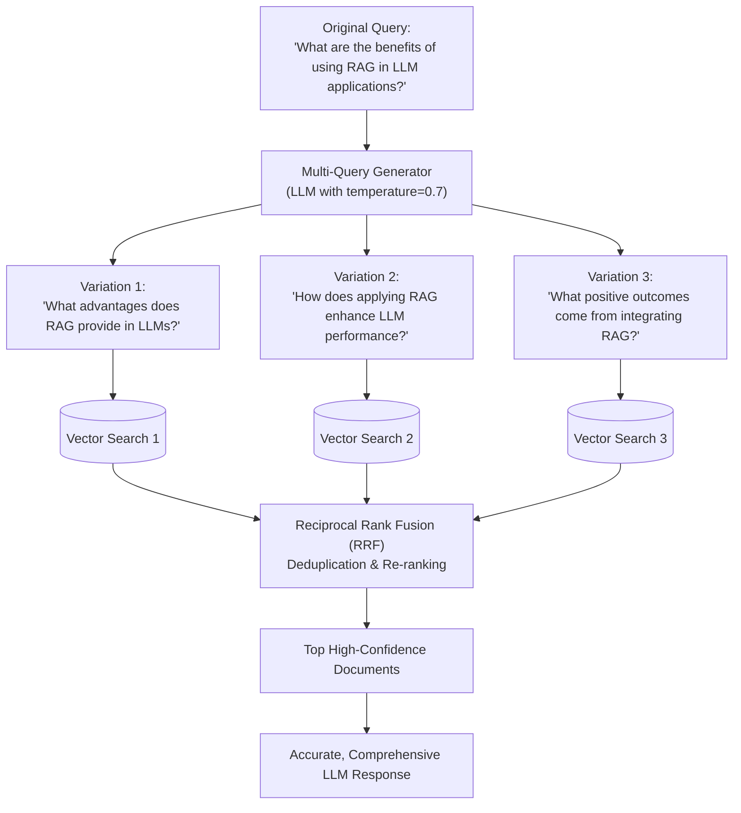

# 04 - Multi-Query Generation

## 1. Concept at a Glance

**Multi-Query Generation** generates **multiple variations and paraphrases** of the *same* question from different linguistic perspectives.

> **Analogy:** If you drop your keys in a dark room, searching with a single narrow laser pointer might miss them. Shining three distinct flashlights from three different angles guarantees you locate them immediately.

---

## 2. Why Phrasing Matters in Vector Databases

Vector embedding models (such as `text-embedding-3-small`, `bge-large`, or `OpenAI ADA`) map sentences into high-dimensional geometric space. Even though modern embeddings capture semantic meaning, **subtle differences in syntax, synonyms, and perspective** can cause the query vector to shift noticeably.

* Phrase A: *"How to reduce LLM hallucination with RAG?"*
* Phrase B: *"Methods for improving factual grounding in generative AI."*
* Phrase C: *"RAG architecture patterns for verification and citation."*

Each of these three queries will surface slightly different top-5 documents in your vector database. By generating all 3 and taking the union of their results, you achieve **dramatically higher retrieval recall**.

---

## 3. Workflow Diagram (with Reciprocal Rank Fusion)



---

## 4. Live Notebook Example

### Input vs. Output

**Original Query:**  
> *"What are the benefits of using RAG in LLM applications?"*

**Generated Variations:**
1. *"What advantages does RAG provide when applied in LLM applications?"*
2. *"How does utilizing RAG enhance the performance of LLM applications?"*
3. *"In what ways can the application of RAG improve LLM processes?"*

Each variation casts a wider net across the embedding index.

---

## 5. Python Implementation

### A. Notebook Implementation (Direct OpenAI Client)
```python
import os
import json
from openai import OpenAI
from dotenv import load_dotenv

load_dotenv()
client = OpenAI(api_key=os.getenv("OPENAI_API_KEY"))

def multi_query_generation(original_query: str, num_queries: int = 3) -> list[str]:
    prompt = f"""You are an AI assistant helping to improve search queries.
    
Generate {num_queries} different versions of the following question. 
Each version should:
- Ask the same thing but from a different perspective
- Use different wording and phrasing
- Help retrieve relevant information from a vector database

Original question: {original_query}

Return ONLY a JSON array of {num_queries} alternative questions, nothing else.
Example format: ["question 1", "question 2", "question 3"]"""

    response = client.chat.completions.create(
        model="gpt-4o",
        messages=[{"role": "user", "content": prompt}],
        temperature=0.7
    )
    
    return json.loads(response.choices[0].message.content)

# Execution
variations = multi_query_generation("What are the benefits of using RAG in LLM applications?")
for i, var in enumerate(variations, 1):
    print(f"{i}. {var}")
```

### B. Built-In LangChain Implementation (`MultiQueryRetriever`)
LangChain provides an automated built-in wrapper that performs generation, retrieval, and deduplication out of the box:

```python
from langchain.retrievers.multi_query import MultiQueryRetriever
from langchain_openai import ChatOpenAI

llm = ChatOpenAI(temperature=0.7, model_name="gpt-4o")

# Automatically runs multi-query retrieval and merges unique documents
multi_retriever = MultiQueryRetriever.from_llm(
    retriever=vectorstore.as_retriever(),
    llm=llm
)

unique_docs = multi_retriever.invoke("What are the benefits of using RAG in LLM applications?")
```

---

## 6. How to Merge Results: Reciprocal Rank Fusion (RRF)

When multiple queries return overlapping documents in different positions, simple concatenation is suboptimal. **Reciprocal Rank Fusion (RRF)** scores documents based on their rank across all lists:

$$\text{RRF Score}(d) = \sum_{q \in Q} \frac{1}{k + \text{rank}(q, d)}$$

*(where $k$ is typically a constant like 60)*

Documents that appear near the top of **multiple** variations get boosted to the highest rank!

---

## Next Up
Explore how to direct queries to the right data source:
👉 [05 - Query Routing](./05_query_routing.md)
