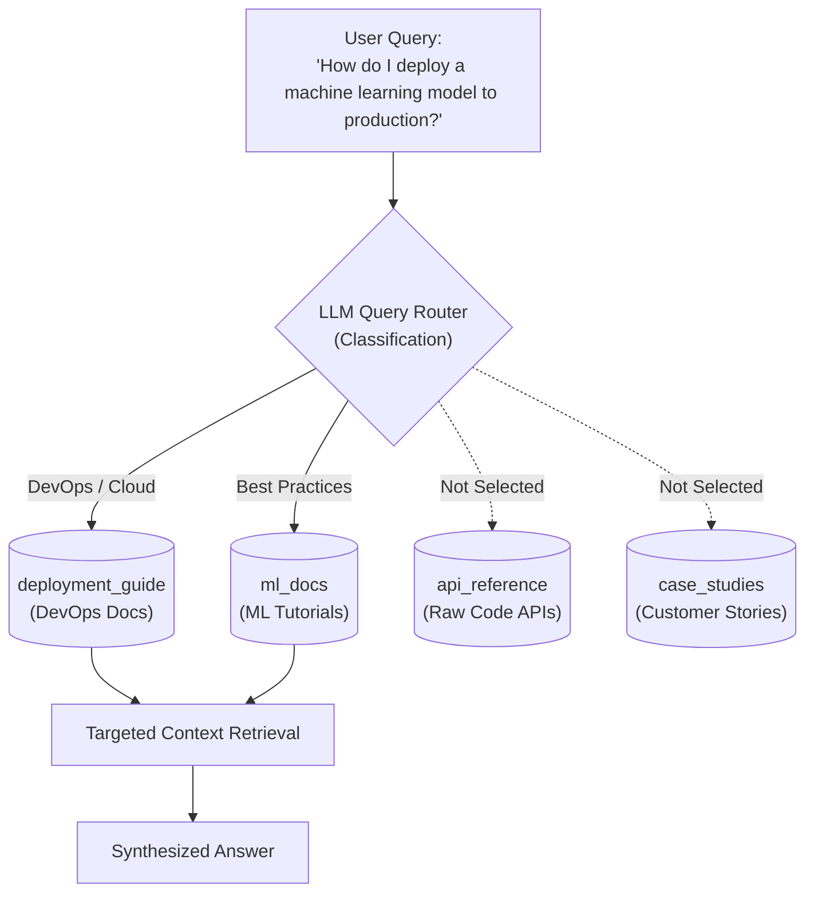

# 05 - Query Routing

## 1. Concept at a Glance

**Query Routing** acts as an **intelligent switchboard** that analyzes the user's question and directs it to the **most relevant database, index, or search engine**.

> **Analogy:** When you call a hospital, you don't ask the receptionist to perform surgery. The receptionist asks your symptoms and routes you to the right department: *Pediatrics, Cardiology, or Radiology*. Query routing does the exact same thing for your data sources.

---

## 2. Why Query Routing is Essential in Modern RAG

In real-world enterprise architectures, data is rarely stored in a single monolithic vector database. You typically have:
1. **SQL Database**: Structured tables (orders, revenue, customer IDs).
2. **Technical Docs Vector Store**: Markdown / PDF documentation.
3. **API Reference Store**: OpenAPI specs and endpoints.
4. **Live Web Search**: Real-time current news and stock prices.

If you blindly query all stores for every single question:
* Latency increases 4x.
* Token and compute costs soar.
* Irrelevant data leaks into the context window, confusing the LLM.

**Query Routing solves this by matching query characteristics to the right specialized storage engine.**

---

## 3. Workflow Diagram



---

## 4. Live Notebook Example

### Input Setup
**Available Data Sources:**
* `ml_docs`: Machine learning tutorials and best practices
* `deployment_guide`: Cloud deployment and DevOps documentation
* `api_reference`: API specifications and code examples
* `case_studies`: Real-world implementation case studies

**User Question:**  
> *"How do I deploy a machine learning model to production?"*

### Routing Result
```json
{
  "selected_sources": ["deployment_guide", "ml_docs"],
  "reasoning": "The 'deployment_guide' is the most relevant source as it contains cloud deployment and DevOps documentation. 'ml_docs' provides additional context on best practices specific to machine learning production workflows."
}
```

Notice how `api_reference` and `case_studies` were correctly excluded, cutting noise by 50%!

---

## 5. Python Implementation

### A. Notebook Implementation (JSON Mode)
```python
import json
from openai import OpenAI
from dotenv import load_dotenv

load_dotenv()
client = OpenAI()

def query_routing(query: str, available_sources: list[dict]) -> dict:
    sources_text = "\n".join([
        f"{i+1}. {source['name']}: {source['description']}" 
        for i, source in enumerate(available_sources)
    ])
    
    prompt = f"""You are a query router. Given a user question and available data sources, 
select the MOST appropriate source(s) to answer the question.

Available Sources:
{sources_text}

User Question: {query}

Return your answer as JSON with this structure:
{{
    "selected_sources": ["source_name1", "source_name2"],
    "reasoning": "brief explanation of why these sources"
}}"""

    response = client.chat.completions.create(
        model="gpt-4o",
        messages=[{"role": "user", "content": prompt}],
        temperature=0.3,
        response_format={"type": "json_object"}
    )
    
    return json.loads(response.choices[0].message.content)
```

### B. Modern Pydantic Schema Routing
```python
from pydantic import BaseModel, Field
from typing import Literal

SourceType = Literal["ml_docs", "deployment_guide", "api_reference", "case_studies"]

class RoutingDecision(BaseModel):
    selected_sources: list[SourceType] = Field(description="List of selected relevant data sources")
    reasoning: str = Field(description="Justification for routing choices")

# Enforces strict enum values from your available source catalog!
```

---

## 6. Routing Strategies: Single vs. Multi-Selector

| Strategy | When to Use | Example Framework Class |
| :--- | :--- | :--- |
| **Single Selector** | Mutually exclusive data domains (e.g. SQL vs. Unstructured PDFs) | `LLMSingleSelector`, `PydanticSingleSelector` |
| **Multi Selector** | Questions spanning cross-functional topics (e.g. Deploying ML models) | `LLMMultiSelector`, `PydanticMultiSelector` |
| **Semantic Router** | Ultra-low latency classification using vector centroids (no LLM call) | `Aurelio / semantic-router` |

---

## Next Up
Explore how to compress verbose questions down to dense keyword queries:
👉 [06 - Query Compression](./06_query_compression.md)
