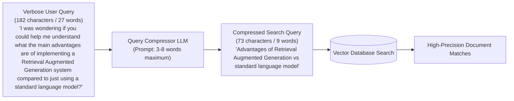

# 06 - Query Compression

## 1. Concept at a Glance

**Query Compression** strips away conversational pleasantries, polite filler words, and irrelevant context from a user's prompt, condensing it into a **dense, high-signal keyword search query**.

> **Analogy:** Sending an old-fashioned telegram. Instead of saying:  
> *"Dearest Aunt Clara, I was just sitting by the fire wondering if perchance you might arrive on the morning locomotive tomorrow?"*  
> The telegram reads:  
> *"ARRIVING TOMORROW MORNING TRAIN STOP"*  
> Same core meaning, 80% fewer words, zero ambiguity!

---

## 2. Why Dense Queries Perform Better in Embedding Search

Vector embedding models (especially dense bi-encoders like OpenAI's `text-embedding-3-small` or Hugging Face's `bge`) calculate cosine similarity based on semantic vectors.

When a query is filled with conversational padding:
* *"I was wondering if you could help me understand..."*
* *"Could you maybe explain to me..."*
* *"In your opinion, what is..."*

These filler tokens dilute the vector representation, dragging the query vector toward generic conversational phrases rather than technical document chunks. **Compressing the query sharpens vector focus.**

---

## 3. Workflow Diagram



---

## 4. Live Notebook Examples

### A. Single Turn Verbose Compression

| Metric | Raw Query | Compressed Query |
| :--- | :--- | :--- |
| **Content** | *"I was wondering if you could help me understand what the main advantages are of implementing a Retrieval Augmented Generation system compared to just using a standard language model?"* | *"Advantages of Retrieval Augmented Generation vs standard language model"* |
| **Length** | 182 characters | 73 characters |
| **Compression Ratio**| Baseline (100%) | **40.1% of original size** |

### B. Compression with Conversation History (Context Resolution)
When a user asks a follow-up question in a chat:
* **Turn 1 (User):** *"Tell me about systems"*
* **Turn 2 (Assistant):** *"Systems combine retrieval with generation..."*
* **Turn 3 (User):** *"What about the implementation details?"*

If you pass *"What about the implementation details?"* alone to the database, it fails.
The compressed query incorporates the prior turn:
> **Compressed Result:** *"Systems implementation details"*

---

## 5. Python Implementation

```python
from openai import OpenAI
from dotenv import load_dotenv

load_dotenv()
client = OpenAI()

def query_compression(query: str, conversation_history: list[dict] = None) -> str:
    context = ""
    if conversation_history:
        context = "\n".join([
            f"{msg['role']}: {msg['content']}" 
            for msg in conversation_history[-3:]
        ])
        context = f"\nConversation History:\n{context}\n"
    
    prompt = f"""You are a query optimization expert. Compress the following query into a concise search query.

{context}
Current Query: {query}

Rules:
- Remove filler words and unnecessary context
- Keep only the core semantic concepts
- Maintain the search intent
- Output should be 3-8 words maximum
- Focus on keywords that would match relevant documents

Return ONLY the compressed query, nothing else."""

    response = client.chat.completions.create(
        model="gpt-4o",
        messages=[{"role": "user", "content": prompt}],
        temperature=0.3
    )
    
    return response.choices[0].message.content.strip()
```

---

## 6. Trade-offs: Compression vs. Expansion

| Dimension | Query Rewriting / Expansion | Query Compression |
| :--- | :--- | :--- |
| **Primary Goal** | High **Recall** (catch everything related) | High **Precision** (eliminate noise) |
| **Best Used For**| Vague, underspecified questions | Verbose, rambling, conversational chat questions |
| **Ideal Output** | 20-50 words | 3-8 words |

---

## Next Up
Explore how to personalize searches using user profile metadata:
👉 [07 - Contextual Query Enhancement](./07_contextual_query_enhancement.md)
