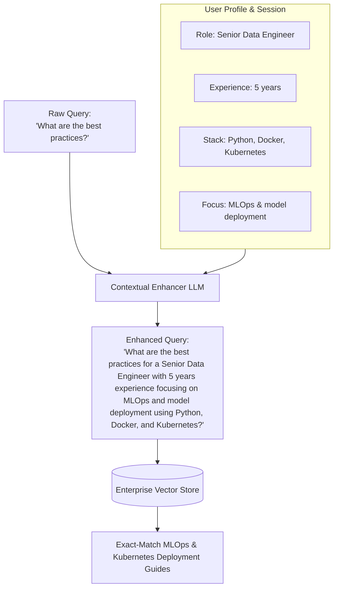

# 07 - Contextual Query Enhancement

## 1. Concept at a Glance

**Contextual Query Enhancement** takes a generic user question and enriches it with **user profile metadata** (role, seniority, tech stack, domain) and **recent conversation history**.

> **Analogy:** If you walk into a shoe store and ask:  
> *"What shoes should I buy?"*  
> An uninformed clerk has to guess. But if the clerk already knows you are a **marathon runner training for rainy road races**, they immediately hand you lightweight, water-resistant carbon-plated racing shoes. Same question, but personalized to perfection!

---

## 2. Why One Size Does NOT Fit All in Search

Consider the query:
> *"How do I optimize model performance?"*

Depending on who is asking, this query has completely different intentions:
* **To a Junior Data Scientist:** It means hyperparameter tuning, learning rate schedules, and cross-validation techniques.
* **To a Senior MLOps Engineer:** It means model quantization (INT8/FP16), TensorRT optimization, horizontal Pod autoscaling in Kubernetes, and reducing p99 latency in production.
* **To a Research Scientist:** It means novel attention mechanisms, loss function formulation, and ablation studies.

If you don't personalize the query before searching your internal documentation, the vector database returns an arbitrary mix of beginners' guides and infrastructure YAMLs.

---

## 3. Workflow Diagram



---

## 4. Live Notebook Example

### One Question, Three Different Roles

**Base Query:**  
> *"How do I optimize model performance?"*

**Enhanced Queries by Persona:**
1. **Data Scientist** *(2 years exp, Deep Learning)*:  
   👉 *"How do I optimize deep learning model performance with 2 years of data science experience?"*
2. **ML Engineer** *(7 years exp, Production Systems)*:  
   👉 *"What are best practices for optimizing machine learning model performance in production systems with 7 years of experience as an ML Engineer?"*
3. **Research Scientist** *(10 years exp, NLP Research)*:  
   👉 *"What are the best practices for optimizing performance of NLP models in research based on a decade of experience as a research scientist?"*

---

## 5. Python Implementation

```python
from openai import OpenAI
from dotenv import load_dotenv

load_dotenv()
client = OpenAI()

def contextual_query_enhancement(
    query: str, 
    user_context: dict[str, str],
    conversation_history: list[dict[str, str]] = None
) -> str:
    context_text = "\n".join([f"- {k}: {v}" for k, v in user_context.items()])
    
    history_text = ""
    if conversation_history:
        history_text = "\n".join([
            f"{msg['role']}: {msg['content']}" 
            for msg in conversation_history[-3:]
        ])
    
    prompt = f"""You are enhancing a search query with contextual information.

User Context:
{context_text}

{f"Recent Conversation:\n{history_text}" if history_text else ""}

Original Query: {query}

Task: Enhance this query by:
1. Adding relevant context from user profile
2. Incorporating conversation history if relevant
3. Making implicit information explicit
4. Keeping it natural and search-friendly

Return ONLY the enhanced query, nothing else."""

    response = client.chat.completions.create(
        model="gpt-4o",
        messages=[{"role": "user", "content": prompt}],
        temperature=0.5
    )
    
    return response.choices[0].message.content.strip()
```

---

## 6. Privacy & Production Best Practices

* **Role-Based Access Control (RBAC):** Use the user profile not only for query enhancement, but also as a security filter in vector retrieval (`metadata={"allowed_roles": user.roles}`).
* **PII Redaction:** Ensure user profile attributes do not leak sensitive personal identifiable information (PII) into vector search logs.

---

## Next Up
Explore how to convert natural language queries into semantic text and hard metadata filters:
👉 [08 - Query Translation to Filters](./08_query_translation_to_filters.md)
