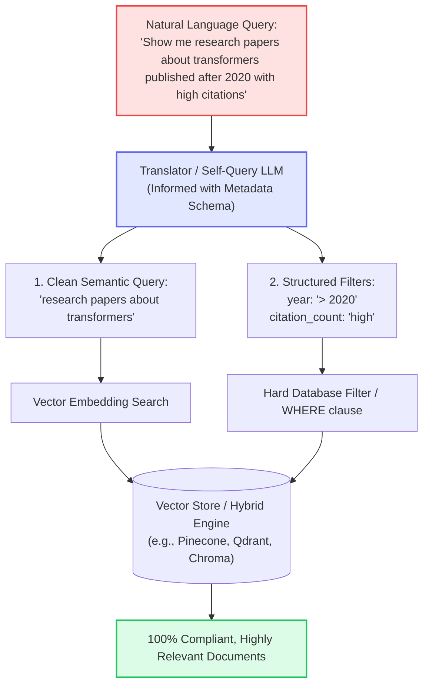

# 08 - Query Translation to Metadata Filters (Self-Querying)

## 1. Concept at a Glance

**Query Translation to Filters** (often called **Self-Querying**) parses a single natural language sentence into two complementary parts:
1. **The Semantic Query:** The pure conceptual topic for vector similarity search.
2. **Structured Metadata Filters:** Hard logical constraints (e.g., date ranges, numeric thresholds, categorical tags, booleans).

> **Analogy:** On an e-commerce site like Amazon, you don't just type into a search bar. You search for *"noise-canceling headphones"* and check the sidebar filters: **Brand: Sony**, **Rating: 4+ Stars**, **Price: Under $300**, **Prime: Yes**.  
> Query translation automates this by reading your sentence and checking all the right sidebar boxes for you!

---

## 2. Why Pure Vector Search Fails with Structured Constraints

Vector embeddings excel at semantic similarity (*"climate change"* $\approx$ *"global warming"*). However, **vector embeddings are notoriously bad at math, timestamps, and hard boundaries**:

* If you search: *"Papers about transformers published after 2022"*
* A pure vector search might return a seminal 2017 paper because the text says: *"Future research after 2022 should explore larger context windows..."*
* The 2017 paper has high semantic similarity, but fails your date constraint!

By combining **Semantic Search + Structured Filtering**, you get the best of both worlds:
```
Filter:   year >= 2022 AND citation_count == 'high'
Search:   vector_similarity("transformers")
```

---

## 3. Workflow Diagram



---

## 4. Live Notebook Examples

### Example 1: Research Paper Repository
* **Input Query:** *"Show me research papers about transformers published after 2020 with high citations"*
* **Extracted Result:**
  ```json
  {
    "semantic_query": "research papers about transformers",
    "filters": {
      "year": "after 2020",
      "citation_count": "high"
    }
  }
  ```

### Example 2: E-Commerce Product Catalog
* **Input Query:** *"Find me highly rated Apple laptops under $1000 that are in stock"*
* **Extracted Result:**
  ```json
  {
    "semantic_query": "Find Apple laptops",
    "filters": {
      "rating": "4, 5",
      "price_range": "under_1000",
      "brand": "Apple",
      "in_stock": "yes"
    }
  }
  ```

---

## 5. Python Implementation

### A. Notebook Implementation
```python
import json
from openai import OpenAI
from dotenv import load_dotenv

load_dotenv()
client = OpenAI()

def query_translation_to_filters(query: str, available_filters: dict[str, list]) -> dict:
    filters_description = "\n".join([
        f"- {field}: {', '.join(map(str, values))}" 
        for field, values in available_filters.items()
    ])
    
    prompt = f"""You are a query translator. Extract the semantic query and metadata filters from a natural language query.

Available Metadata Filters:
{filters_description}

Natural Language Query: {query}

Parse this into:
1. A semantic search query (the conceptual question)
2. Metadata filters (specific attributes to filter on)

Return JSON in this format:
{{
    "semantic_query": "the core question without filter terms",
    "filters": {{
        "field_name": "value or condition"
    }}
}}

Only include filters that are explicitly mentioned in the query."""

    response = client.chat.completions.create(
        model="gpt-4o",
        messages=[{"role": "user", "content": prompt}],
        temperature=0.2,
        response_format={"type": "json_object"}
    )
    
    return json.loads(response.choices[0].message.content)
```

### B. LangChain Built-In `SelfQueryRetriever`
LangChain has native support for translating directly into vector store-specific query filters (supporting Chroma, Pinecone, Qdrant, Weaviate, etc.):

```python
from langchain.chains.query_constructor.base import AttributeInfo
from langchain.retrievers.self_query.base import SelfQueryRetriever
from langchain_openai import ChatOpenAI

metadata_field_info = [
    AttributeInfo(name="year", description="Year the paper was published", type="integer"),
    AttributeInfo(name="topic", description="Primary research field (e.g. transformers, CNN)", type="string"),
    AttributeInfo(name="citation_count", description="Citation level: low, medium, high", type="string"),
]

retriever = SelfQueryRetriever.from_llm(
    llm=ChatOpenAI(model="gpt-4o", temperature=0),
    vectorstore=vectorstore,
    document_contents="Abstract and summary of AI research papers",
    metadata_field_info=metadata_field_info
)
```

---

## Next Up
Explore how to orchestrate all these transformations into an autonomous Agent:
👉 [09 - Advanced RAG Architecture & Agents](./09_agentic_rag_and_frameworks.md)
