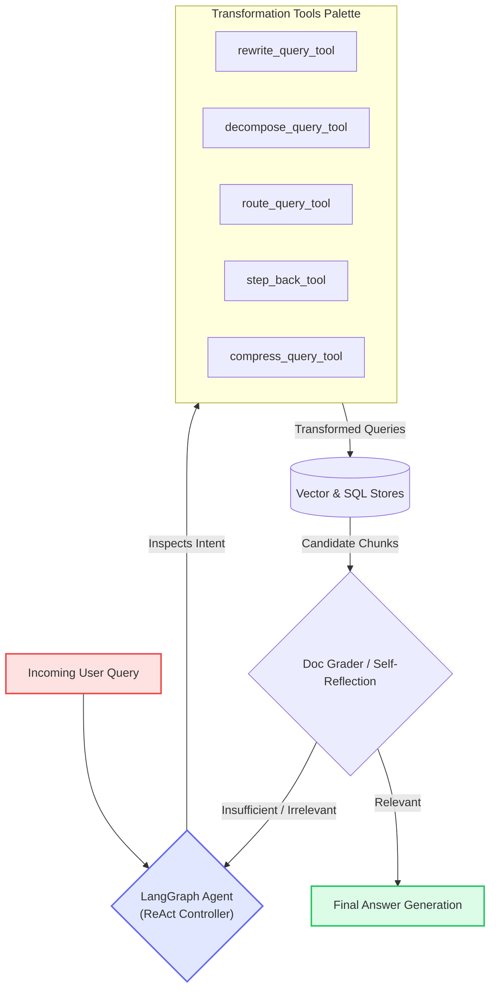

# 09 - Agentic RAG and Framework Comparison

## 1. From Static Pipelines to Agentic RAG

In traditional pipelines, every query goes through the exact same sequence of steps (e.g., *Always Rewrite $\rightarrow$ Always Retrieve $\rightarrow$ Always Generate*).

This causes inefficiencies:
* A simple question (*"What time does the store close?"*) doesn't need 3 sub-queries or a step-back abstraction.
* A complex comparison (*"Compare Google Gemini 1.5 Pro and OpenAI GPT-4o architecture and latency"*) requires multiple parallel tools and comparison synthesis.

**Agentic RAG** introduces an autonomous LLM Agent (using **LangGraph**) equipped with query transformation tools. The agent evaluates the query, picks the best transformation on the fly, evaluates retrieval results, and can iterate until satisfied.

---

## 2. Agentic Query Transformation Architecture



---

## 3. LangChain vs. LlamaIndex Comparison

| Feature | LangChain Pattern | LlamaIndex Pattern |
| :--- | :--- | :--- |
| **Multi-Query** | `MultiQueryRetriever` (paraphrases + RRF) | `SubQuestionQueryEngine` (parallel sub-questions) |
| **Sequential Decomposition** | Custom LangGraph cycle | `MultiStepQueryEngine` + `StepDecomposeQueryTransform` |
| **Routing** | Query analysis router / LangGraph conditional edge | `RouterQueryEngine` with `PydanticSingleSelector` |
| **Hypothetical Doc (HyDE)** | `HypotheticalDocumentEmbedder` | `HyDEQueryTransform` (wraps query engine) |
| **Metadata Filtering** | `SelfQueryRetriever` | `VectorStoreIndex` with extracted `MetadataFilters` |
| **Agent Framework** | `langgraph.prebuilt.create_react_agent` | `OpenAIAgent` / `ReActAgent` |

---

## 4. Building the Query Transformation Agent with LangGraph

Here is how to bundle the notebook's functions into modern tools and create an autonomous agent with **LangGraph** (already installed in `agentcv`):

```python
from langchain_openai import ChatOpenAI
from langchain_core.tools import tool
from langgraph.prebuilt import create_react_agent
from dotenv import load_dotenv

load_dotenv()

# 1. Define transformation tools
@tool
def rewrite_query_tool(query: str) -> str:
    """Useful when a query is too brief, ambiguous, or lacks specific technical keywords."""
    # Calls your rewrite_query function
    return f"Rewritten query with expanded context for: {query}"

@tool
def decompose_query_tool(query: str) -> list[str]:
    """Useful when a query asks multiple distinct questions or requires comparing several items."""
    # Calls your decompose_query function
    return [f"Sub-question 1 for {query}", f"Sub-question 2 for {query}"]

@tool
def step_back_tool(query: str) -> str:
    """Useful for hyperspecific edge cases where foundational high-level theory is needed."""
    # Calls your generate_step_back_query function
    return f"High-level foundational concept for: {query}"

# 2. Bind tools to model
tools = [rewrite_query_tool, decompose_query_tool, step_back_tool]
llm = ChatOpenAI(model="gpt-4o", temperature=0)

# 3. Create the Agent
agent = create_react_agent(llm, tools)

# 4. Run the Agent
response = agent.invoke({
    "messages": [("user", "Compare the impacts of climate change on agriculture vs marine life")]
})

print(response["messages"][-1].content)
```

The agent automatically chooses whether to decompose, rewrite, or step back depending on the question complexity!

---

## Next Up
View the comprehensive table of contents and learning roadmap:
👉 [README - Query Transformation Curriculum](./README.md)
