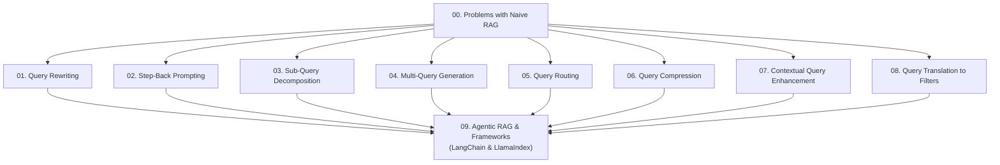

# Query Transformations in RAG Systems: Complete Documentation

Welcome to the comprehensive guide to **Query Transformations for Retrieval-Augmented Generation (RAG)**. This documentation provides intuitive explanations, diagrams, concrete before-and-after examples, and production code for each technique demonstrated in `04_query_transformations.ipynb`.

---

## 🗺️ Curriculum & Navigation



### Table of Contents

| # | Chapter | Core Problem Solved | Key Pattern |
| :-: | :--- | :--- | :--- |
| **00** | [Problems with Naive RAG](./00_problem_with_naive_rag.md) | Semantic gap, ambiguous queries, and multi-intent failures | Foundation |
| **01** | [Query Rewriting](./01_query_rewriting.md) | Vague, brief queries that miss technical document vocabulary | LCEL Rewriting Chain |
| **02** | [Step-Back Prompting](./02_step_back_prompting.md) | Hyperspecific questions missing foundational context | High-level abstraction |
| **03** | [Sub-Query Decomposition](./03_sub_query_decomposition.md) | Complex multi-aspect questions diluted into a single vector | Parallel sub-questions |
| **04** | [Multi-Query Generation](./04_multi_query_generation.md) | High sensitivity to phrasing and synonyms | Reciprocal Rank Fusion (RRF) |
| **05** | [Query Routing](./05_query_routing.md) | Monolithic querying across diverse specialized databases | Intelligent Switchboard |
| **06** | [Query Compression](./06_query_compression.md) | Conversational pleasantries and filler tokens diluting vector density | Telegram-style condensing |
| **07** | [Contextual Query Enhancement](./07_contextual_query_enhancement.md) | One-size-fits-all retrieval ignoring user role and history | Persona & Context Injection |
| **08** | [Query Translation to Filters](./08_query_translation_to_filters.md) | Vector similarity failing on dates, prices, and hard ranges | Semantic + Metadata Hybrid |
| **09** | [Agentic RAG & Frameworks](./09_agentic_rag_and_frameworks.md) | Inflexible static sequential pipelines | LangGraph ReAct Agent |

---

## 🚀 How to Run the Accompanying Code
All patterns are implemented and validated in [04_query_transformations.ipynb](../04_query_transformations.ipynb).

1. Ensure your dependencies are installed:
   ```bash
   pip install -r requirements.txt
   ```
2. Configure your OpenAI credentials in `.env`:
   ```env
   OPENAI_API_KEY=your_key_here
   ```
3. Run the notebook in Jupyter or your favorite IDE.
